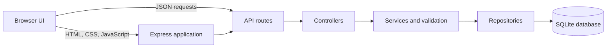

# Ledger

**A full-stack book inventory application built with Node.js, Express, SQLite, and vanilla JavaScript.**

Ledger lets a user browse and search a seeded book catalog, manage titles and stock, and view inventory statistics from a responsive browser interface. The Express application serves both the frontend and its JSON API; SQLite provides local, persistent storage.

## At A Glance

| Area | Implementation |
| --- | --- |
| Frontend | HTML, CSS, browser JavaScript |
| Backend | Node.js 22, Express 4 |
| Database | SQLite through Node's built-in `node:sqlite` API |
| Tests | Jest and Supertest |

## Features

- Search books by title, author, or ISBN, and filter by category.
- Create, edit, and delete catalog entries.
- Increase or decrease stock with validation that prevents negative inventory.
- View title counts, available copies, and a category breakdown.
- Enforce required fields, year/price/quantity ranges, ISBN length, and ISBN uniqueness.
- Run API tests against isolated temporary SQLite databases.

## Architecture



The backend separates HTTP handling from business rules and persistence:

- **Routes** map URLs and HTTP methods to controller actions.
- **Controllers** translate requests into service calls and HTTP responses.
- **Services** validate input and coordinate catalog and stock operations.
- **Repositories** execute parameterized SQLite queries.
- **`createApp(db)`** accepts a database connection, allowing tests to use disposable databases instead of the developer's data file.

## Run Locally

Requires **Node.js 22**. From the workspace root:

```powershell
cd nodejs
npm ci
npm run db:init
npm start
```

Open [http://localhost:3000](http://localhost:3000). The database is created at `nodejs/data/books.db` by default and seeded when it is empty.

Configuration:

| Variable | Default | Purpose |
| --- | --- | --- |
| `PORT` | `3000` | HTTP port |
| `DB_PATH` | `nodejs/data/books.db` | SQLite database file |

For example, in PowerShell use `$env:PORT = "3001"` before `npm start`; in Git Bash use `PORT=3001 npm start`.

## API

All endpoints return JSON unless a successful delete returns an empty `204` response.

| Method | Endpoint | Description |
| --- | --- | --- |
| `GET` | `/api/books` | List books; optional `q` and `category` query parameters |
| `GET` | `/api/books/search?q=...` | Search by title, author, or ISBN |
| `GET` | `/api/books/:id` | Get one book |
| `POST` | `/api/books` | Create a book |
| `PUT` | `/api/books/:id` | Replace editable book fields |
| `PATCH` | `/api/books/:id/stock` | Apply a non-zero integer `adjustment` |
| `DELETE` | `/api/books/:id` | Delete a book |
| `GET` | `/api/categories` | List available categories |
| `GET` | `/api/dashboard/stats` | Get catalog totals and books by category |

Example stock adjustment:

```http
PATCH /api/books/1/stock
Content-Type: application/json

{"adjustment": -1}
```

Validation errors return `400`, missing books return `404`, and duplicate ISBNs return `409`. Unexpected server errors return a generic `500` response.

## Test

```powershell
npm test
```

The Jest/Supertest suite covers listing, lookup, search, category filtering, create/update/delete, duplicate ISBN handling, stock changes, dashboard totals, and serving the catalog page.

## Interview Talking Points

- **Why split routes, controllers, services, and repositories?** Each layer has a clear responsibility, which keeps HTTP details out of business rules and SQL out of request handlers.
- **How are persistence concerns tested?** `createApp(db)` makes the database injectable; each test creates and closes its own temporary SQLite file.
- **How are duplicate records and stock invariants protected?** SQLite enforces the unique ISBN constraint, while services validate input and reject stock changes that would go below zero.
- **What would change for a larger production deployment?** Add authentication and authorization, structured logging and monitoring, graceful shutdown, migration management, and a database selected for concurrent multi-user workloads.

## Scope And Limitations

This is a local inventory demonstration, not a production-hardened service. It does not include authentication or role-based permissions, so do not expose it to an untrusted network. ISBN validation checks for 10 or 13 digits after removing hyphens; it does not validate ISBN check digits. Node may print an experimental-feature warning because `node:sqlite` is experimental in the targeted Node 22 release.