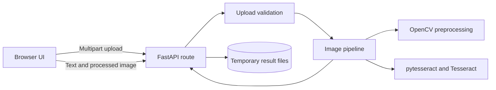

# Scribe

**A browser-based handwriting image recognition demo built with FastAPI, OpenCV, and Tesseract OCR.**

Scribe accepts JPG and PNG uploads, validates and processes each image, and presents the recognized text with a processing-time estimate. The FastAPI app serves the browser interface as well as the JSON recognition API.

## At A Glance

| Area | Implementation |
| --- | --- |
| Web application | FastAPI and Uvicorn |
| Image processing | OpenCV, NumPy, Pillow |
| Text recognition | Tesseract through `pytesseract` |
| Frontend | HTML, CSS, browser JavaScript |
| Tests | Pytest and FastAPI `TestClient` |

## Features

- Upload JPG or PNG images up to 5 MiB.
- Preview the selected image before processing.
- Return recognized text, a processing-time measurement, and a processed-image preview.
- Copy recognized text from the results panel.
- Save result text and processed images under generated, unguessable result IDs.
- Preserve image aspect ratio while fitting within the 800 by 600 processing bounds.
- Downloadable-text and processed-image endpoints.
- Validate file extension, declared MIME type, image signature, size, and filename.

## Architecture



The main responsibilities are split across small modules:

- **Routes** handle the page, upload request, and result retrieval.
- **Validation utilities** check upload names, formats, MIME types, signatures, and the size limit.
- **Preprocessing** decodes, resizes, grayscales, blurs, and thresholds images.
- **Recognition** configures Tesseract and requests English OCR with page segmentation mode 7.
- **The pipeline** coordinates processing and measures elapsed time.
- **File utilities** store result text and processed PNGs outside the source tree by default.

## Run Locally

Requires **Python 3.11** and the **Tesseract OCR executable**. On Windows, install Tesseract using the [UB Mannheim Windows installer](https://github.com/UB-Mannheim/tesseract/wiki). The default executable path is `C:\Program Files\Tesseract-OCR\tesseract.exe`.

From the workspace root in PowerShell:

```powershell
cd python
python -m venv .venv
.\.venv\Scripts\Activate.ps1
python -m pip install -r requirements.txt
uvicorn app.main:app --reload
```

Open [http://localhost:8000](http://localhost:8000).

If Tesseract is installed elsewhere, set its executable path before starting the app:

```powershell
$env:TESSERACT_CMD = "C:\path\to\tesseract.exe"
uvicorn app.main:app --reload
```

## Configuration

| Variable | Default | Purpose |
| --- | --- | --- |
| `TESSERACT_CMD` | `C:\Program Files\Tesseract-OCR\tesseract.exe` when present; otherwise Tesseract is resolved by the environment | Tesseract executable path |
| `RESULT_DIR` | System temporary directory plus `handwriting-results` | Where result text and processed PNG files are stored |

## API

| Method | Endpoint | Description |
| --- | --- | --- |
| `GET` | `/` | Serve the Scribe upload interface |
| `POST` | `/api/recognize` | Accept a multipart form field named `file`; return result ID, text, timing, and filename |
| `GET` | `/api/results/{result_id}/download` | Download recognized text as a `.txt` file |
| `GET` | `/api/results/{result_id}/processed.png` | Retrieve the processed PNG image |

Example request:

```bash
curl -X POST http://localhost:8000/api/recognize \
  -F "file=@handwritten-note.png"
```

Invalid uploads and unreadable images return `400`; a missing upload is rejected by FastAPI with `422`; processing failures return `500`; and unknown result IDs return `404`.

## Test

```powershell
python -m pytest
```

The tests cover the home page, PNG/JPEG upload handling, missing and invalid files, oversized uploads, unsafe filenames, text downloads, the image passed to OCR, and aspect-ratio-preserving resize behavior. OCR is mocked in recognition tests, so the test suite does not require Tesseract to produce real recognized text.

Optional sample generation:

```powershell
python scripts/generate_samples.py
```

## Interview Talking Points

- **Why validate both MIME type and file signature?** The client-provided MIME type is not proof of content; checking the signature catches common mismatches before image decoding.
- **Why separate preprocessing from OCR?** Image transformations can be changed and tested independently from the external recognition engine.
- **How are result files addressed?** A UUID-based ID keeps original user filenames out of result paths; the result ID is validated before file access.
- **How would this scale beyond a local demo?** Move result storage to managed object storage, add expiration and cleanup, put OCR work on a background queue, and add authentication, resource limits, and observability.

## Scope And Limitations

- Recognition is configured for English and a single-line page segmentation mode; results will vary with handwriting, image quality, and layout.
- OCR tests use a mock and do not measure recognition quality with the Tesseract executable.
- This is a local demonstration, not a production-hardened upload service. It has no authentication, result cleanup policy, or background job queue.